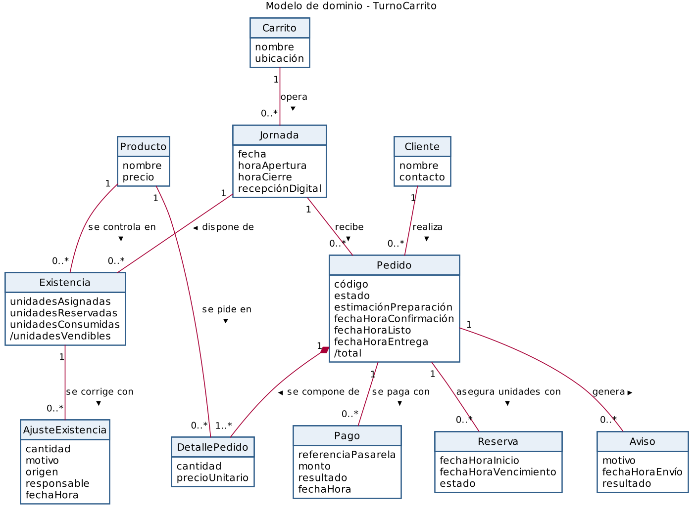

# Modelo de dominio

## Diagrama

Archivo fuente: [`./diagramas/modelo-dominio.puml`](./diagramas/modelo-dominio.puml)

## Descripción de las clases

| Clase | Qué representa en el negocio | Atributos |
|-------|------------------------------|-----------|
| Carrito | El puesto de comida que vende a los clientes y que opera por jornadas. | nombre, ubicación |
| Jornada | Un día de operación de un carrito, durante el cual se asignan unidades al canal digital y se reciben pedidos. | fecha, horaApertura, horaCierre, recepciónDigital (abierta o cerrada) |
| Producto | Un artículo que el carrito ofrece a la venta. | nombre, precio |
| Existencia | Las unidades de un producto asignadas al canal digital en una jornada y el uso que se ha hecho de ellas. | unidadesAsignadas, unidadesReservadas, unidadesConsumidas, /unidadesVendibles (derivado: unidadesAsignadas − unidadesReservadas − unidadesConsumidas) |
| AjusteExistencia | Una corrección registrada sobre las unidades de una existencia, con su motivo y su responsable. | cantidad, motivo, origen, responsable, fechaHora |
| Cliente | La persona que realiza pedidos y a quien se le avisa sobre ellos. | nombre, contacto |
| Pedido | La compra anticipada de uno o más productos, desde que se arma hasta que se entrega. | código, estado, estimaciónPreparación (informativa), fechaHoraConfirmación, fechaHoraListo, fechaHoraEntrega, /total (derivado: suma de cantidad × precioUnitario de sus detalles) |
| DetallePedido | Cada producto con su cantidad dentro de un pedido, al precio que el cliente aceptó. | cantidad, precioUnitario |
| Pago | Un intento de pago de un pedido hecho a través de la pasarela de pago externa; el negocio solo conserva su referencia y su resultado. | referenciaPasarela, monto, resultado (pendiente, rechazado o confirmado), fechaHora |
| Reserva | La retención transitoria de las unidades de un pedido mientras su pago está en curso; su plazo propuesto es de 3 minutos. | fechaHoraInicio, fechaHoraVencimiento, estado (activa, consumida, liberada o vencida) |
| Aviso | Una comunicación al cliente sobre su pedido, por ejemplo que está listo o que cambió su estimación. | motivo, fechaHoraEnvío, resultado (enviado o fallido) |

## Asociaciones

| Asociación | Clases | Multiplicidades | Justificación |
|------------|--------|-----------------|----------------|
| opera | Carrito – Jornada | 1 a 0..* | Una jornada es siempre de un solo carrito, y un carrito acumula jornadas a lo largo del tiempo (HU-08). |
| dispone de | Jornada – Existencia | 1 a 0..* | Al abrir la jornada, el vendedor asigna unidades de cada producto al canal digital; cada existencia pertenece a una sola jornada (HU-08, RP-12). |
| se controla en | Producto – Existencia | 1 a 0..* | Un producto tiene como máximo una existencia por jornada, y esa existencia determina cuántas unidades se pueden vender (HU-01, RP-01). |
| se corrige con | Existencia – AjusteExistencia | 1 a 0..* | Cada ajuste queda registrado sobre la existencia que modifica (HU-08, RP-12). |
| realiza | Cliente – Pedido | 1 a 0..* | Todo pedido lo realiza un cliente, y un cliente puede hacer varios pedidos (HU-02). |
| recibe | Jornada – Pedido | 1 a 0..* | Los pedidos se reciben dentro de una jornada con la recepción digital abierta; cerrar la jornada no borra los pedidos abiertos (HU-08). |
| se compone de | Pedido – DetallePedido | 1 a 1..* | Un pedido tiene al menos un producto, y cada detalle pertenece a un solo pedido (HU-02, RP-02). |
| se pide en | Producto – DetallePedido | 1 a 0..* | Cada detalle se refiere a un producto, y un producto puede aparecer en muchos detalles (HU-02, RP-02). |
| se paga con | Pedido – Pago | 1 a 0..* | Un pedido puede necesitar varios intentos de pago si uno es rechazado o cancelado; cada pago corresponde a un solo pedido (HU-03, RP-04). |
| asegura unidades con | Pedido – Reserva | 1 a 0..* | Cada intento de pago reserva las unidades del pedido y una reserva vencida no se reutiliza, por lo que un pedido puede tener varias reservas con una sola activa (HU-04, RP-05). |
| genera | Pedido – Aviso | 1 a 0..* | Un pedido genera avisos (listo para retiro, cambio de estimación); cada aviso se refiere a un solo pedido (HU-06, RP-10). |

## Decisiones de modelado

- **Roles que se modelaron como rol y no como clase:** Estudiante, Vendedor y Encargado son roles de los actores del sistema, no conceptos con datos propios del negocio, por eso no son clases. El estudiante actúa como Cliente; se conserva esa clase solo porque el negocio necesita saber a quién pertenece cada pedido y a quién avisarle, y no se crea una subclase Estudiante porque el carrito no trata distinto a sus clientes. La intervención del vendedor tampoco necesita una clase: queda en el atributo responsable de AjusteExistencia y en las fechas y horas de cambio de estado del Pedido.
- **Uso de agregación o composición:** se usó composición entre Pedido y DetallePedido, porque un detalle no tiene sentido fuera de su pedido y comparte su ciclo de vida. No se usó agregación ni herencia: ninguna otra relación es de parte a todo con ciclo de vida compartido, y no hay conceptos con especializaciones que tengan atributos o reglas propias (los tipos de Aviso solo difieren en su motivo).
- **Sistemas externos fuera del modelo:** la pasarela de pago y el software de ventas que el vendedor ya usa son sistemas externos, no clases del dominio. Del primero el negocio solo conserva la referencia y el resultado en Pago; la relación con el segundo se expresa en las unidades asignadas de Existencia y en el origen de cada AjusteExistencia.
- **Atributos derivados:** /total y /unidadesVendibles expresan reglas del negocio (RP-01, RP-02) y no se registran por separado.
- **Fuera de este modelo:** el cargo de empaque (RP-21, HU-10) y la política de pedidos pagados y no retirados no se modelan, porque siguen pendientes de validar desde la Entrega 1.
