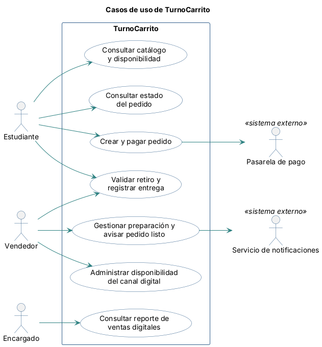

# Casos de uso

[← Documento maestro](./IngReq-Entrega%202.md)

Los casos de uso describen **objetivos que un actor quiere lograr con TurnoCarrito**. Cada actor corresponde a un rol de las historias de usuario de la Entrega 1 y a una clase o sistema del [modelo de dominio](./08-modelo-dominio.md), y cada caso de uso proviene de una o más historias de [04-historias-usuario.md](./04-historias-usuario.md).

## Actores

| Actor | Tipo (humano / sistema externo) | Descripción |
|-------|----------------------------------|-------------|
| Estudiante | Humano | Consulta productos y disponibilidad, arma y paga su pedido, consulta su estado y presenta el código para retirarlo. |
| Vendedor | Humano | Atiende el carrito: prepara los pedidos confirmados, avisa que están listos, confirma la entrega y administra la disponibilidad del canal digital. |
| Encargado | Humano | Consulta las ventas digitales y los rechazos por falta de stock para apoyar la reposición. |
| Pasarela de pago | Sistema externo | Procesa el pago del pedido y comunica su resultado (aprobado, rechazado o tardío). El proveedor aún no está definido. |
| Servicio de notificaciones | Sistema externo | Entrega al estudiante el aviso de pedido listo. El canal (push, SMS u otro) aún no está definido. |

## Diagrama de casos de uso

Archivo fuente: [`./diagramas/09-casos-de-uso.puml`](./diagramas/09-casos-de-uso.puml)

## Casos de uso y su origen

| ID | Caso de uso (objetivo del actor) | Actor principal | Sistema externo | Historia de origen |
|----|-----------------------------------|-----------------|-----------------|---------------------|
| CU-01 | Consultar catálogo y disponibilidad | Estudiante | — | [HU-01](./04-historias-usuario.md#hu-01-consultar-disponibilidad-antes-de-desplazarse) |
| CU-02 | Crear y pagar pedido | Estudiante | Pasarela de pago | [HU-02](./04-historias-usuario.md#hu-02-armar-un-pedido-y-conocer-su-total), [HU-03](./04-historias-usuario.md#hu-03-pagar-y-consultar-el-progreso-del-pedido), [HU-04](./04-historias-usuario.md#hu-04-mantener-reservadas-las-unidades-durante-el-pago) |
| CU-03 | Gestionar preparación y avisar pedido listo | Vendedor | Servicio de notificaciones | [HU-05](./04-historias-usuario.md#hu-05-organizar-la-preparación-de-pedidos-digitales), [HU-06](./04-historias-usuario.md#hu-06-actualizar-preparación-y-avisar-que-el-pedido-está-listo) |
| CU-04 | Validar retiro y registrar entrega | Vendedor (el Estudiante presenta el código) | — | [HU-07](./04-historias-usuario.md#hu-07-retirar-un-pedido-identificado) |
| CU-05 | Consultar reporte de ventas digitales | Encargado | — | [HU-09](./04-historias-usuario.md#hu-09-consultar-ventas-digitales-para-apoyar-la-reposición) |
| CU-06 | Administrar disponibilidad del canal digital | Vendedor | — | [HU-08](./04-historias-usuario.md#hu-08-mantener-disponibilidad-compatible-con-el-software-existente) |
| CU-07 | Consultar estado del pedido | Estudiante | — | [HU-03](./04-historias-usuario.md#hu-03-pagar-y-consultar-el-progreso-del-pedido) |

## Descripción de los casos de uso

### CU-01 — Consultar catálogo y disponibilidad
- **Objetivo:** conocer productos, precios y unidades vendibles antes de desplazarse al carrito.
- **Flujo principal:** el estudiante solicita el catálogo; TurnoCarrito presenta nombre, precio, unidades vendibles y hora de la última actualización de cada producto.
- **Alternativas:** un producto sin unidades vendibles se presenta como agotado y no puede agregarse a un pedido; si la disponibilidad no puede verificarse, se advierte y no se permite iniciar un pago.

### CU-02 — Crear y pagar pedido
- **Objetivo:** comprar productos por adelantado y obtener un pedido confirmado con su código de retiro.
- **Flujo principal:** el estudiante elige productos y cantidades; TurnoCarrito calcula el total; el estudiante lo acepta; TurnoCarrito revalida disponibilidad y precio y reserva las unidades; solicita el pago a la Pasarela de pago; la pasarela informa pago aprobado; TurnoCarrito confirma el pedido una sola vez, registra la venta, asigna el código y lo incorpora a la cola del vendedor.
- **Alternativas:** cantidad superior a la vendible; cambio de precio o disponibilidad antes del pago (requiere nueva aceptación del total); pago rechazado (se libera la reserva y se permite reintentar); reserva vencida o pago informado tarde (el pedido queda en conciliación y no pasa a preparación); respuesta repetida de la pasarela (no se duplica pedido ni venta).

### CU-03 — Gestionar preparación y avisar pedido listo
- **Objetivo:** organizar la preparación de los pedidos confirmados y comunicar al estudiante que su pedido está listo.
- **Flujo principal:** el vendedor consulta la cola ordenada por fecha y hora de confirmación; inicia la preparación de un pedido; al terminar lo marca como listo; TurnoCarrito registra el cambio y solicita el aviso al Servicio de notificaciones.
- **Alternativas:** el aviso no se entrega (el estado listo se conserva y se registra el fallo); el vendedor está sin conexión (la actualización queda pendiente de sincronización y se valida contra el estado vigente); un pedido sin pago confirmado no puede marcarse como listo.

### CU-04 — Validar retiro y registrar entrega
- **Objetivo:** entregar el pedido correcto una sola vez.
- **Flujo principal:** el estudiante presenta el código de su pedido; el vendedor lo consulta; TurnoCarrito verifica que esté pagado y listo; el vendedor confirma la entrega; TurnoCarrito registra fecha y hora y conserva el pedido en el historial.
- **Alternativas:** código inexistente; pedido no pagado, no listo o ya entregado (se rechaza la entrega); sin conexión no se confirma una entrega definitiva.

### CU-05 — Consultar reporte de ventas digitales
- **Objetivo:** apoyar la reposición con datos de ventas del canal digital.
- **Flujo principal:** el encargado elige una jornada; TurnoCarrito presenta unidades vendidas, ingresos digitales, distribución por franja horaria y rechazos por falta de stock agrupados por producto, indicando que la cobertura es solo digital.
- **Alternativas:** pagos rechazados y reservas vencidas no se cuentan como ventas; las transacciones en conciliación se identifican por separado; sin conciliación con las ventas presenciales, el reporte no se presenta como total del negocio.

### CU-06 — Administrar disponibilidad del canal digital
- **Objetivo:** controlar qué se puede vender por el canal digital sin comprometer unidades ya reservadas o pagadas.
- **Flujo principal:** el vendedor autorizado abre o cierra la recepción de pedidos digitales, o registra un ajuste de disponibilidad (producto, cantidad, origen y motivo); TurnoCarrito valida que no contradiga reservas ni pedidos confirmados, registra responsable y fecha y hora, y actualiza la disponibilidad.
- **Alternativas:** un ajuste incompatible con unidades comprometidas se rechaza y se muestra la discrepancia; mientras la recepción está cerrada no se admiten nuevos pagos; sin un mecanismo de inventario validado no se habilitan pagos reales.

### CU-07 — Consultar estado del pedido
- **Objetivo:** saber si el pedido fue confirmado, en qué estado está y cuándo retirarlo.
- **Flujo principal:** el estudiante consulta su pedido; TurnoCarrito presenta código de retiro, estado, detalle y la estimación disponible, rotulada como informativa.
- **Alternativas:** sin parámetros vigentes se informa que la estimación no está disponible; si hay atraso se comunica el estado o la estimación actualizados, sin cancelar el pedido.

## Decisiones de modelado

- **Sin `include` ni `extend`.** La validación de disponibilidad y el intercambio con la pasarela son pasos obligatorios del flujo de CU-02 y no objetivos reutilizables por otros actores; modelarlos como casos de uso aparte los convertiría en funciones técnicas.
- **Pago y seguimiento separados.** HU-03 reúne dos objetivos: pagar (parte de CU-02) y consultar el progreso (CU-07). Se separan porque el estudiante consulta su pedido muchas veces después del pago.
- **Software de ventas existente fuera del diagrama.** Su integración no está acordada, por lo que no se representa como sistema externo. Si el vendedor valida una integración, aparecerá asociado a CU-01, CU-05 y CU-06.
- **Servicio de notificaciones como sistema externo.** Se mantiene genérico porque la Entrega 1 no define el canal; coincide con el participante de DSS-02.
- **CU-04.** El actor principal es el Vendedor, que valida y registra la entrega. El Estudiante participa presentando el código; por eso ambos se asocian al caso de uso.
- **HU-10 (cargo de empaque)** es una historia candidata sin caso de uso propio mientras no se apruebe el cargo; de aprobarse, se incorporaría al cálculo del total de CU-02.
