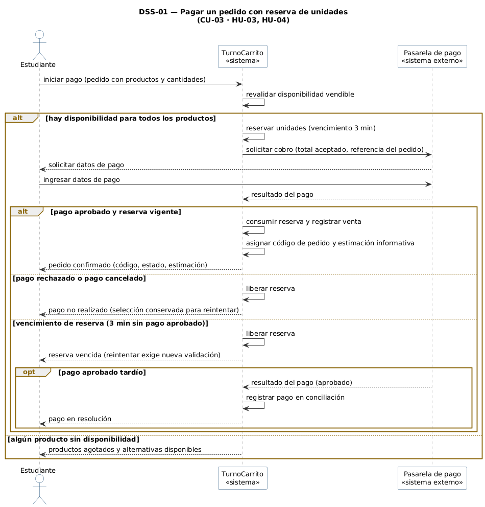
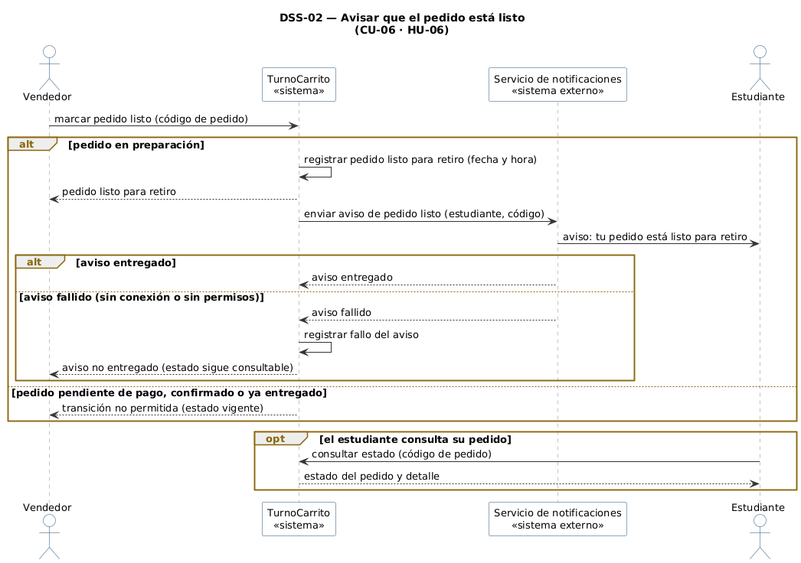

# Diagramas de secuencia de sistema

[← Documento maestro](./IngReq-Entrega%202.md)

Los diagramas muestran a **TurnoCarrito** como una sola caja negra y a los sistemas externos como participantes. Los mensajes usan el vocabulario del negocio y siguen el flujo del [proceso TO-BE](./02-rediseno-to-be.md) de la Entrega 1. Los estados que se mencionan (*pendiente de pago*, *listo para retiro*, etc.) son los mismos de los [diagramas de estado](./11-diagramas-estado.md).

## DSS-01 — Pagar un pedido con reserva de unidades

- Caso de uso: [CU-03](./09-casos-de-uso.md)
- Historia: [HU-03](./04-historias-usuario.md#hu-03-pagar-y-consultar-el-progreso-del-pedido) y [HU-04](./04-historias-usuario.md#hu-04-mantener-reservadas-las-unidades-durante-el-pago)
- Sistemas externos que participan: Pasarela de pago
- Actividades TO-BE: AC-02, AC-03, AC-04 y AC-05

Archivo fuente: [`./diagramas/dss-01.puml`](./diagramas/dss-01.puml)

Escenario principal: el estudiante inicia el pago y TurnoCarrito revalida la disponibilidad y reserva las unidades por 3 minutos. Luego solicita el cobro a la pasarela, que pide los datos de pago directamente al estudiante (RP-18). Con el pago aprobado y la reserva vigente, el sistema consume la reserva, registra la venta y entrega el código de pedido con su estimación informativa.

Variantes representadas:

- **`alt` sin disponibilidad:** si algún producto se agotó, no se reserva ni se cobra; se informan los productos agotados y las alternativas disponibles (HU-02 CA4, RP-03).
- **`alt` pago rechazado o cancelado:** se libera la reserva y se conserva la selección para reintentar (HU-03 CA4, RP-05).
- **`alt` vencimiento de reserva:** pasados 3 minutos sin pago aprobado, se libera la reserva; reintentar exige una nueva validación (HU-04 CA3 y CA5).
- **`opt` pago aprobado tardío:** si la aprobación llega después del vencimiento, el pago queda en conciliación y se informa *pago en resolución* (HU-04 CA4, Derivación 1).

## DSS-02 — Avisar que el pedido está listo

- Caso de uso: [CU-06](./09-casos-de-uso.md)
- Historia: [HU-06](./04-historias-usuario.md#hu-06-actualizar-preparación-y-avisar-que-el-pedido-está-listo)
- Sistemas externos que participan: Servicio de notificaciones
- Actividades TO-BE: AC-07

Archivo fuente: [`./diagramas/dss-02.puml`](./diagramas/dss-02.puml)

Escenario principal: el vendedor marca el pedido como listo y TurnoCarrito registra el estado *listo para retiro* con fecha y hora. Después solicita al servicio de notificaciones el aviso al estudiante, y el servicio confirma que el aviso fue entregado.

Variantes representadas:

- **`alt` transición no permitida:** si el pedido no está *en preparación* (pendiente de pago, confirmado o ya entregado), el sistema rechaza la marca e informa el estado vigente (HU-06 CA1, RP-09).
- **`alt` aviso fallido:** si el aviso no llega por falta de conexión o de permisos, se registra el fallo y se informa al vendedor; el estado sigue consultable (HU-06 CA4, RP-10).
- **`opt` consulta del estudiante:** el estudiante puede consultar el estado de su pedido con su código en cualquier momento, aunque el aviso no le haya llegado (RP-10).

## Correspondencia con los diagramas de estado

| Mensaje en la secuencia | Evento en el diagrama de estado | Transición |
|---|---|---|
| iniciar pago (DSS-01) | iniciar pago | EST-01: inicio → Pendiente de pago · EST-02: inicio → Activa |
| resultado del pago: aprobado (DSS-01) | pago aprobado | EST-01: Pendiente de pago → Confirmado · EST-02: Activa → Consumida |
| resultado del pago: rechazado o cancelado (DSS-01) | pago rechazado / pago cancelado | EST-01: Pendiente de pago → Pago no realizado · EST-02: Activa → Liberada |
| vencimiento de reserva (DSS-01) | vencimiento de reserva | EST-01: Pendiente de pago → Pago no realizado · EST-02: Activa → Liberada |
| resultado del pago: aprobado tardío (DSS-01) | pago aprobado tardío | EST-01: Pago no realizado → En conciliación |
| marcar pedido listo (DSS-02) | marcar pedido listo | EST-01: En preparación → Listo para retiro |
