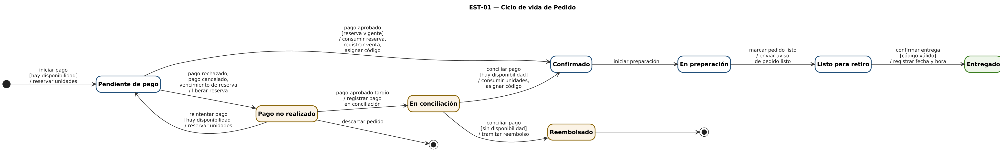
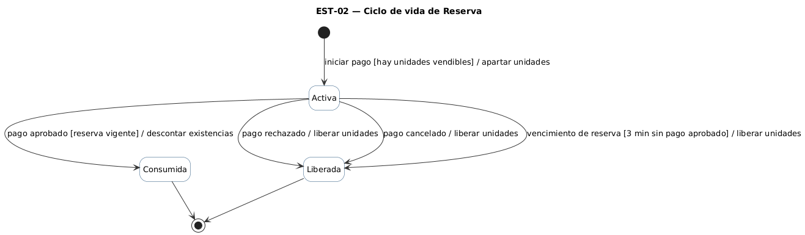

# Diagramas de estado

[← Documento maestro](./IngReq-Entrega%202.md)

Se modelan las dos clases del dominio cuyo ciclo de vida guía el proceso [TO-BE](./02-rediseno-to-be.md): el **Pedido**, desde que se inicia el pago hasta que se entrega, y la **Reserva** de unidades, que protege el stock mientras el pago está en curso. Los eventos coinciden con los mensajes de los [diagramas de secuencia](./10-diagramas-secuencia.md).

## EST-01 — Ciclo de vida de Pedido

- Clase del dominio: [Pedido](./08-modelo-dominio.md)
- Diagramas de secuencia relacionados: [DSS-01](./10-diagramas-secuencia.md#dss-01--pagar-un-pedido-con-reserva-de-unidades) y [DSS-02](./10-diagramas-secuencia.md#dss-02--avisar-que-el-pedido-está-listo)
- Historias: HU-03, HU-04, HU-06 y HU-07
- Requisitos: RP-04, RP-05, RP-09, RP-11

Archivo fuente: [`./diagramas/est-01.puml`](./diagramas/est-01.puml)

### Tabla de transiciones

| Estado origen | Evento | Guarda | Acción | Estado destino |
|---|---|---|---|---|
| (inicial) | iniciar pago | hay disponibilidad | reservar unidades | Pendiente de pago |
| Pendiente de pago | pago aprobado | reserva vigente | consumir reserva, registrar venta, asignar código | Confirmado |
| Pendiente de pago | pago rechazado | — | liberar reserva | Pago no realizado |
| Pendiente de pago | pago cancelado | — | liberar reserva | Pago no realizado |
| Pendiente de pago | vencimiento de reserva | 3 min sin pago aprobado | liberar reserva | Pago no realizado |
| Pago no realizado | reintentar pago | hay disponibilidad | reservar unidades | Pendiente de pago |
| Pago no realizado | pago aprobado tardío | — | registrar pago en conciliación | En conciliación |
| Pago no realizado | descartar pedido | — | — | (final) |
| En conciliación | conciliar pago | hay disponibilidad | consumir unidades, asignar código | Confirmado |
| En conciliación | conciliar pago | sin disponibilidad | tramitar reembolso | Reembolsado |
| Confirmado | iniciar preparación | — | — | En preparación |
| En preparación | marcar pedido listo | — | enviar aviso de pedido listo | Listo para retiro |
| Listo para retiro | confirmar entrega | código válido | registrar fecha y hora | Entregado |
| Entregado | — | — | — | (final) |
| Reembolsado | — | — | — | (final) |

Decisiones de modelado:

- *Pago no realizado* no es final: HU-03 CA4 exige conservar la selección para reintentar. El reintento vuelve a validar disponibilidad y crea una reserva nueva (HU-04 CA5).
- *En conciliación* y *Reembolsado* modelan el pago aprobado después del vencimiento (Derivación 1): el pedido solo se confirma si se obtiene stock; si no, se tramita la reversa y nunca pasa a preparación.
- No se modela un estado para pedidos pagados y no retirados, porque esa política está fuera de alcance según [03-requisitos.md](./03-requisitos.md#fuera-de-alcance-y-decisiones-pendientes). Un pedido listo permanece en *Listo para retiro* hasta su entrega.

## EST-02 — Ciclo de vida de Reserva

- Clase del dominio: [Reserva](./08-modelo-dominio.md)
- Diagramas de secuencia relacionados: [DSS-01](./10-diagramas-secuencia.md#dss-01--pagar-un-pedido-con-reserva-de-unidades)
- Historias: HU-04 y HU-08
- Requisitos: RP-05, RP-16; Derivación 1

Archivo fuente: [`./diagramas/est-02.puml`](./diagramas/est-02.puml)

### Tabla de transiciones

| Estado origen | Evento | Guarda | Acción | Estado destino |
|---|---|---|---|---|
| (inicial) | iniciar pago | hay unidades vendibles | apartar unidades | Activa |
| Activa | pago aprobado | reserva vigente | descontar existencias | Consumida |
| Activa | pago rechazado | — | liberar unidades | Liberada |
| Activa | pago cancelado | — | liberar unidades | Liberada |
| Activa | vencimiento de reserva | 3 min sin pago aprobado | liberar unidades | Liberada |
| Consumida | — | — | — | (final) |
| Liberada | — | — | — | (final) |

Decisiones de modelado:

- Una reserva se consume o se libera **una sola vez**: ambos estados son finales, así que una respuesta repetida de la pasarela no puede volver a descontar ni a liberar stock (HU-04 CA2 y CA3, RP-16).
- Una reserva liberada no se reutiliza. Un reintento crea una reserva nueva (HU-04 CA5).
